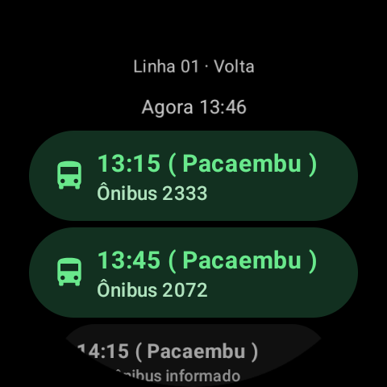
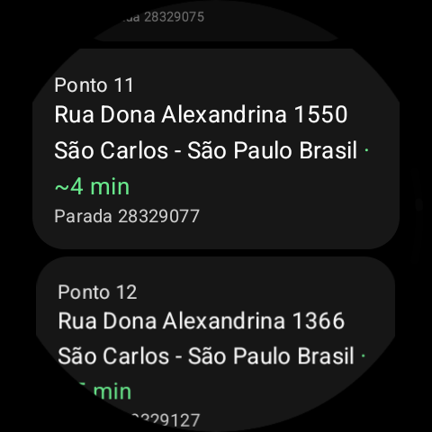
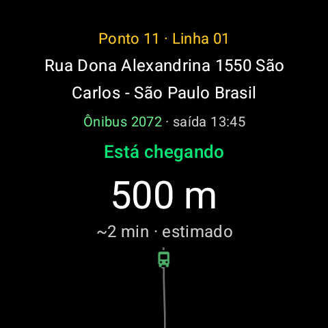
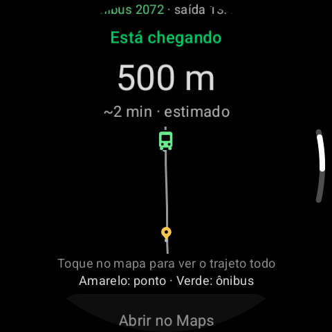

# SOU Watch

**Horários, pontos e acompanhamento de ônibus de São Carlos no seu smartwatch Wear OS.**

Projeto de TCC de Vitor Fantini. A versão atual dos fontes é **1.4.8** (`versionCode 13`). O app consulta as linhas **01, 06 e 32**, mostra o veículo associado à saída escolhida e apresenta estimativas para os pontos que ele ainda vai atender.

> Projeto acadêmico independente. O SOU Watch não é o aplicativo oficial SOU. Os horários e as posições dependem dos dados disponibilizados pela operadora; os minutos exibidos são estimativas calculadas pelo projeto.

[Baixar APK 1.4.7](https://github.com/VitorFantini/SOU-Watch/releases/download/v1.4.7/SouWatch-1.4.7.apk) · [Versões e downloads](https://github.com/VitorFantini/SOU-Watch/releases)

## Conheça o aplicativo

<p align="center">
  
  
  
</p>
<p align="center">
  
  
</p>

*Capturas do emulador. As telas de acompanhamento da 1.4.8 usam posições simuladas sobre um trajeto registrado para conferir o visual. As demais imagens mostram consultas anteriores; nenhuma imagem representa dados atuais.*

- **Linhas e sentidos:** escolha a linha, o sentido e uma saída confirmada para o dia, usando o horário do relógio.
- **Ônibus localizado:** horários com GPS recente recebem caixa verde e ícone de ônibus em verde-claro.
- **Minutos na lista de pontos:** o nome da parada recebe `~XX min` em verde apenas se ela estiver adiante do ônibus no trajeto. Pontos já passados, GPS vencido e posições inconclusivas ficam sem essa estimativa.
- **Acompanhamento de um ponto:** título amarelo, identificação do ônibus verde, distância em metros ou quilômetros e tempo estimado. Os estados são **Já passou** (vermelho), **Está chegando** (verde forte, até 600 m pelo trajeto) e **Ainda não passou** (verde claro). Posição incerta ou GPS desatualizado geram mensagem neutra. A tolerância de passagem é de 80 m; uma primeira posição após a parada não comprova passagem observada.
- **Favoritos:** segure uma parada para favoritar. Pontos com nomes iguais são identificados separadamente por linha, sentido e identidade da parada.
- **Mapas esquemáticos:** o acompanhamento e o Tile compartilham o desenho local do trajeto, com ponto amarelo e ônibus verde. No acompanhamento, toque no mapa para alternar a aproximação e o trajeto completo. O marcador e os valores do ônibus são ocultados ao expirar o GPS.
- **Tile Meu ponto:** salve uma parada, acompanhe a próxima previsão elegível e abra o mapa ampliado.
- **Interface para relógio:** fundo preto, botões escuros, marca em amarelo, textos claros e indicador de rolagem.

### Linhas disponíveis

| Linha | Percurso de referência |
|---|---|
| 01 | Pacaembu × UFSCar Norte |
| 06 | Cardinalli × Vila São José |
| 32 | Monte Carlo × Paulistano |

Os percursos específicos e as partidas são consultados na fonte de dados. Uma linha pode ter variações de trajeto ou não ter partidas confirmadas em determinado dia.

## Como as estimativas funcionam

O app associa a consulta à viagem, sentido, horário e veículo selecionados. Calcula a distância ao longo do itinerário e usa uma velocidade de referência de **300 m/min (18 km/h)**, arredondando a estimativa para cima, com mínimo de um minuto.

Esses minutos não incorporam um modelo de trânsito, semáforos ou tempo de embarque. GPS com mais de **120 segundos**, projeção ambígua ou veículo fora do traçado não devem produzir minutos verdes na lista. Uma saída programada no Tile representa o horário de saída do terminal, não uma chegada confirmada ao ponto.

As telas de consulta são atualizadas a cada **20 segundos enquanto o app está visível**. A lista usa uma consulta de veículo por ciclo para calcular as previsões das paradas, reutilizando as projeções do trajeto. O Tile reutiliza consultas por pelo menos 20 segundos e expira resultados antigos. O mapa é desenhado localmente, sem carregar mapas de fundo pela rede.

A autonomia de bateria e a precisão dos minutos em campo ainda precisam de medições no relógio físico.

## Compatibilidade e APK

- Relógio **Wear OS**, com API Android 30 ou superior, conforme o `minSdk` do projeto.
- Acesso à internet no relógio para consultar horários e veículos.
- Interface verificada no emulador Galaxy Watch 7 de 480 × 480. Isso não garante teste em todos os modelos.
- Aplicativo instalado diretamente no relógio; não há app complementar de celular neste projeto.

O APK da última versão publicada é **`SouWatch-1.4.7.apk`**, disponível em [Releases](https://github.com/VitorFantini/SOU-Watch/releases/tag/v1.4.7). Os fontes atuais da **1.4.8** podem ser compilados conforme a próxima seção; o arquivo gerado pode ser renomeado para `SouWatch-1.4.8.apk`. O guia de instalação ao final usa a 1.4.7 como exemplo e também se aplica ao APK novo.

O APK preparado para testes usa a variante **debug**, assinada com a chave de desenvolvimento deste computador. A chave privada não faz parte do repositório. Compilações em outros computadores podem ter assinatura diferente e não permitir atualização sobre uma instalação existente.

## Compilar e verificar

Use Android Studio, **JDK 21**, Android SDK Platform **34** e Android SDK Build Tools. O projeto inclui o Gradle Wrapper. Configure o caminho do SDK pelo Android Studio ou por um `local.properties` local, que não deve ser versionado.

No PowerShell, a partir da raiz do projeto:

```powershell
.\gradlew.bat assembleDebug testDebugUnitTest lintDebug
```

O APK será gerado em:

```text
app/build/outputs/apk/debug/app-debug.apk
```

Os testes unitários cobrem calendário, vínculo de partida e veículo, validade do GPS, projeção no trajeto, passagem, favoritos e estimativas por parada. Com um emulador Wear OS de testes conectado, também é possível executar:

```powershell
.\gradlew.bat connectedDebugAndroidTest
```

Use um emulador separado para os testes instrumentados: a instalação/limpeza realizada pelo Gradle pode afetar o app e os Tiles configurados nesse dispositivo de testes.

## Organização do projeto

```text
app/src/main/             Aplicativo Android/Wear OS, interface e Tile
app/src/test/             Testes unitários
app/src/androidTest/      Testes Android do Tile
docs/imagens/             Capturas da interface
```

APKs gerados, configurações locais e chaves de assinatura ficam fora do controle de versão. Os APKs para instalação são distribuídos por GitHub Releases.

## Como instalar no seu smartwatch

### 1. Prepare o computador e o relógio

Baixe e extraia o [Android SDK Platform Tools](https://developer.android.com/tools/releases/platform-tools). Tenha o `SouWatch-1.4.7.apk` no computador. Conecte computador e relógio à mesma rede Wi-Fi, sem isolamento entre dispositivos.

No Galaxy Watch, abra **Configurações → Sobre o relógio → Informações do software** e toque repetidamente em **Versão do software** até habilitar as opções de desenvolvedor. Volte às configurações, abra **Opções do desenvolvedor** e ative **Depuração ADB** e **Depuração sem fio**. Os nomes podem variar conforme a versão do sistema.

### 2. Pareie o computador

Na tela de depuração sem fio do relógio, toque em **Parear novo dispositivo**. Anote o IP e a porta de pareamento. No PowerShell, aberto na pasta `platform-tools`, execute:

```powershell
.\adb.exe pair IP_DO_RELOGIO:PORTA_DE_PAREAMENTO
```

Digite o código mostrado no relógio quando solicitado.

### 3. Conecte e instale

Volte à tela principal de **Depuração sem fio** e use o IP e a **porta de conexão** indicados ali. Essa porta pode ser diferente da usada no pareamento.

```powershell
.\adb.exe connect IP_DO_RELOGIO:PORTA_DE_CONEXAO
.\adb.exe devices -l
```

Com o relógio listado como `device`, instale. Substitua o endereço e o caminho abaixo pelos valores reais:

```powershell
.\adb.exe -s IP_DO_RELOGIO:PORTA_DE_CONEXAO install -r "C:\caminho\SouWatch-1.4.7.apk"
```

A mensagem `Success` confirma a instalação. Abra **SouWatch** na lista de aplicativos do relógio. O `-r` tenta atualizar preservando os dados, desde que a assinatura seja compatível.

Se aparecer `INSTALL_FAILED_UPDATE_INCOMPATIBLE`, a instalação existente usa outra assinatura. Preserve a versão instalada e seus dados; será necessário um APK assinado com a mesma chave para atualizá-la sem desinstalar. Se aparecer `offline`, `unauthorized` ou falha de conexão, confirme a autorização no relógio e consulte novamente o IP e a porta atuais.

### 4. Configure o Tile Meu ponto

No app, toque em **Meu ponto · Tile**, escolha linha, sentido, percurso e parada. No carrossel de Tiles do relógio, adicione **Meu ponto · SOU Watch**. Use **Atualizar**, **Abrir app** e **Trocar ponto** conforme necessário. O nome Tile pode aparecer como bloco ou widget no sistema.

Ao terminar a instalação, você pode desativar a depuração sem fio nas opções de desenvolvedor. O app continuará usando a conexão normal à internet do relógio.

Referências para conexão e instalação: [Samsung — conectar o Galaxy Watch](https://developer.samsung.com/health/sensor/guide/connect-watch.html), [Android — depuração do Wear OS por Wi-Fi](https://developer.android.com/training/wearables/get-started/debug-wifi) e [Android — comandos ADB](https://developer.android.com/tools/adb).
